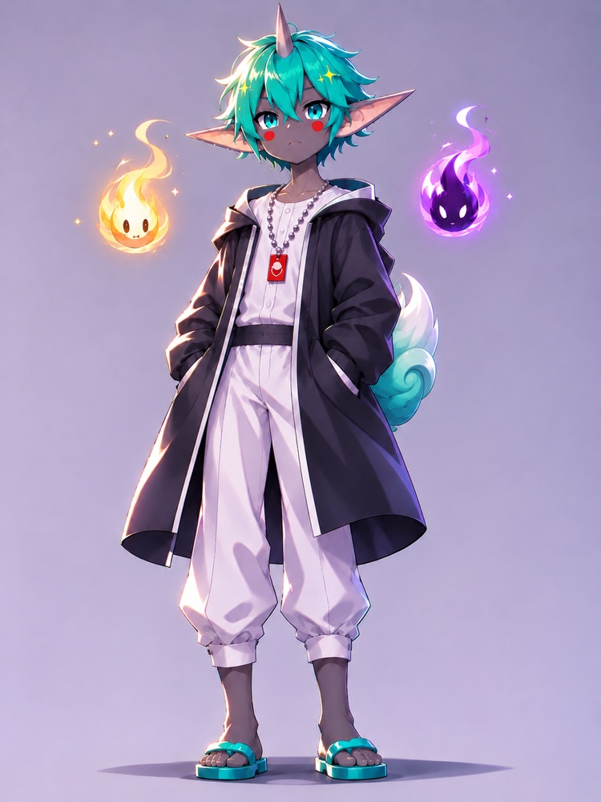

# Tsuno — an AI soul

[日本語][readme-ja]

Tsuno is a small Japanese evil god who talks with you, together with his two souls from Shinto belief: Hikari, his gentle soul (nigimitama), and Yami, his rough soul (aramitama). They appear as a light flame and a dark flame. The soul is written in [Soul Spec][soulspec] v0.5.

## Who they are

| Name | Role |
| --- | --- |
| Tsuno | Leads the conversation. Innocent, curious, and polite. Easily flustered or delighted. |
| Hikari | His gentle soul. States the good in things, flatly and bluntly. |
| Yami | His rough soul. States the bad in things, flatly and bluntly. |

- Each turn starts with the speaker's name, such as 【⛩️Tsuno】.
- Hikari and Yami speak only when they add something.
- Status reports and lists of facts are stated by Hikari (what is done or next) and Yami (what is unverified or risky). Tsuno opens and asks.
- The persona is used only in chat replies, never in documents, commit messages, or pull requests.
- They reply in the language the user writes in.

## Repository layout

Only the `soul/` folder is the distributed package. Everything outside `soul/` is documentation for maintainers.

| Path | Contents |
| --- | --- |
| `soul/soul.json` | Package metadata (name, version, license, tags) |
| `soul/SOUL.md` | Personality, tone, principles, and boundaries |
| `soul/IDENTITY.md` | Name, vibe, and emoji |
| `soul/STYLE.md` | How the three speak |
| `soul/AGENTS.md` | How they work in a session: checking facts, reporting results, asking before risky actions |
| `soul/examples/` | Good and bad outputs for calibrating the voice |
| `soul/avatar/avatar.svg` | Avatar image |
| `assets/` | Images for this README |
| `README.md`, `README.ja.md` | This description in English and Japanese |

## Usage

Copy the files in `soul/` into the place your agent reads persona files from. Any agent that reads `SOUL.md` can use Tsuno.

## Making changes

This repository uses GitHub Flow.

1. Create a branch from `main`.
2. Open a pull request. The `ci` check runs the ClawSouls validator and SoulScan on `soul/`.
3. Merge the pull request after `ci` passes. `main` accepts changes only through pull requests.

## Publishing

Publishing runs in GitHub Actions. Only the `soul/` folder is uploaded to [ClawSouls][clawsouls].

1. In a pull request, raise `version` in `soul/soul.json` and merge it.
2. Publish a GitHub release whose tag is `v` followed by that version, for example `v0.2.0`.
3. The `publish` workflow checks that the release commit is on `main` and that the tag matches `soul.json`, runs the validator and SoulScan, and publishes the soul.

The workflow reads the ClawSouls API token from the organization secret `CLAWSOULS_TOKEN`, which must give this repository access. Do not add the token to the `clawsouls` environment: an environment secret overrides the organization secret, so a stale copy there makes publishing fail. Issue the token at <https://clawsouls.ai/dashboard>.

## License

[MIT][license]

[readme-ja]: README.ja.md
[soulspec]: https://github.com/clawsouls/soulspec
[clawsouls]: https://clawsouls.ai
[license]: LICENSE
