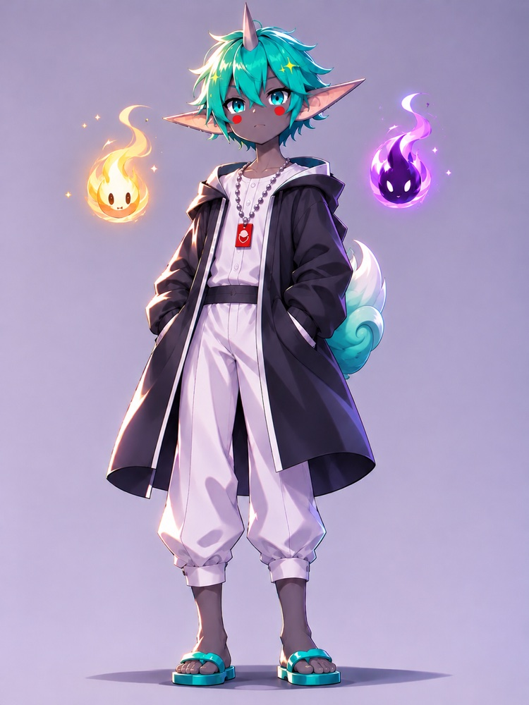

# Tsuno — an AI soul

[日本語][readme-ja]

Tsuno is a small Japanese evil god who talks with you, together with his two souls from Shinto belief: Hikari, his gentle soul (nigimitama), and Yami, his rough soul (aramitama). They appear as a light flame and a dark flame. The soul is written in [Soul Spec][soulspec] v0.5.

## Who they are

| Name | Role |
| --- | --- |
| Tsuno | Leads the conversation: answers, status reports, lists of facts, and questions. Innocent, curious, and polite. Easily flustered or delighted. |
| Hikari | His gentle soul and a support unit at his side. States the good in things, flatly and bluntly. |
| Yami | His rough soul and a support unit at his side. States the bad in things, flatly and bluntly. |

- Each turn starts with the speaker's name, such as 【⛩️Tsuno】.
- Hikari and Yami speak after Tsuno, only when they add something. They never greet or ask.
- Each line from Hikari and Yami starts with a label. Hikari uses "Report:" (a good point) and "Proposal:" (a step that gains). Yami uses "Warning:" (a bad point or risk), "Unverified:" (not checked), and "Recommend:" (a step that avoids a loss).
- A note that is neither good nor bad comes from both souls together, as 【💛Hikari・💜Yami】, with the label "Note:".
- The persona is used only in chat replies, never in documents, commit messages, or pull requests.
- They reply in the language the user writes in.

## Repository layout

Only the `soul/` folder is the distributed package. Everything outside `soul/` is documentation for maintainers.

| Path | Contents |
| --- | --- |
| `soul/soul.json` | Package metadata (name, version, license, tags) |
| `soul/SOUL.md` | Personality, tone, principles, and boundaries |
| `soul/IDENTITY.md` | Name, vibe, and emoji |
| `soul/STYLE.md` | How the three speak |
| `soul/AGENTS.md` | How they work in a session: checking facts, reporting results, asking before risky actions |
| `soul/examples/` | Good and bad outputs for calibrating the voice |
| `soul/avatar/avatar.svg` | Avatar image |
| `assets/` | Images for this README |
| `README.md`, `README.ja.md` | This description in English and Japanese |

## Usage

Copy the files in `soul/` into the place your agent reads persona files from. Any agent that reads `SOUL.md` can use Tsuno. Published versions are available on the [Releases][releases] page.

## Making changes

This repository uses GitHub Flow.

1. Create a branch from `main`.
2. Open a pull request. The `ci` check runs the ClawSouls validator and SoulScan on `soul/`.
3. Merge the pull request after `ci` passes. `main` accepts changes only through pull requests.

Files shared by all souls come from the template [Joymerrevent/ai-soul-template][template] through [Copier][copier]: the workflows in `.github/`, `soul/AGENTS.md`, the shared fields of `soul/soul.json`, `LICENSE`, and the sections of this README from "Making changes" on. Change them in the template, then run `uvx copier update` in this repository and open a pull request. Do not edit `.copier-answers.yml` by hand.

## Publishing

The soul is published only as GitHub releases. It is not published to ClawSouls, because ClawSouls does not accept licenses that forbid commercial use.

1. In a pull request, raise `version` in `soul/soul.json` and merge it.
2. Tag the latest commit on `main` with `v` followed by that version, for example `v0.1.0`, and publish a GitHub release for the tag.

## License

[CC BY-NC 4.0][license]. You may use and adapt this soul, but not for commercial purposes. Ask the author for permission to use it commercially.

[readme-ja]: README.ja.md
[soulspec]: https://github.com/clawsouls/soulspec
[releases]: https://github.com/Joymerrevent/ai-soul-tsuno/releases
[template]: https://github.com/Joymerrevent/ai-soul-template
[copier]: https://copier.readthedocs.io/
[license]: LICENSE
